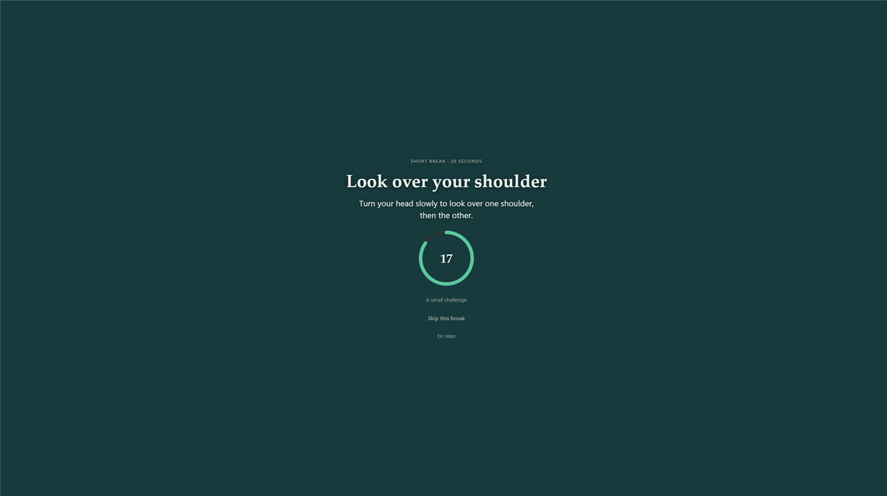
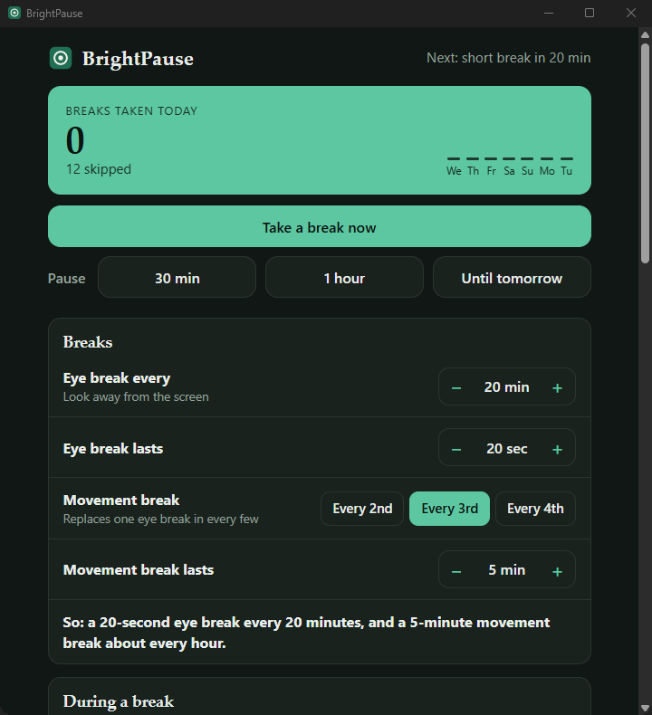
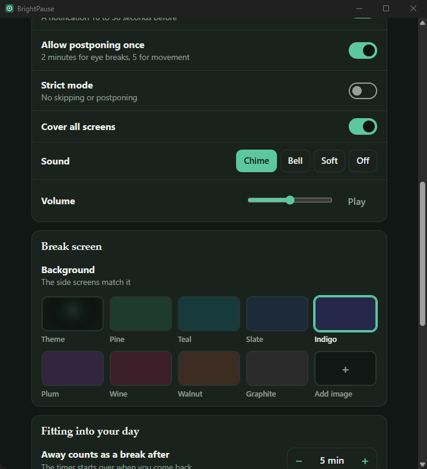
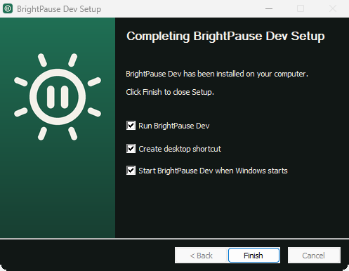

# BrightPause

A light break reminder for Windows. It sits in the tray, and every 20 minutes it covers your screens with a calm 20-second break: look far away, blink, roll your shoulders. Every third break is a 5-minute movement break. Each break shows a short message, a tip with its source, or a small challenge.

> **Status:** early. There are no installers yet: the first release waits for code signing, so Windows will trust it. You can build it yourself (below).

## No network unless you ask

BrightPause makes no network connections unless you press **Check for updates** in settings, or turn on **Automatic updates** (off by default; then it checks at most once a day). It has no accounts, no analytics and no telemetry. An available update shows as a small dot on the tray icon and a line in settings, never as a pop-up. Updates are verified against a signing key before they install. (The installer itself downloads Microsoft's WebView2 runtime only on a PC that lacks it; Windows 11 has it built in.)

Settings and break history stay on your PC, in `%APPDATA%\io.github.jordanalbayrak.brightpause\`: `settings.json`, `history.jsonl` (one line per break) and, if you pick one, your background picture. The Microsoft Store version has no update check at all, as the Store delivers updates. Full details: [PRIVACY.md](PRIVACY.md).

## What it does

- Breaks on every screen, with a countdown, postpone (up to twice: 2 minutes for an eye break, 5 for a movement break) and skip. Strict mode removes both.
- No break during a call: while another app records from your microphone (Teams, Zoom, a call in the browser), the break waits until the call ends. Checked on your PC only; it can be switched off. A call with only the camera on is not detected.
- Pause from the tray in one click: 30 minutes, 1 hour, or until tomorrow.
- Away from the keyboard for 5 minutes? That counts as a break, and the timer starts over. Breaks also wait while a full-screen app or Do Not Disturb is on.
- Break screen: the light or dark theme, eight plain colours, or your own picture (dimmed so the text stays readable). The side screens match.
- English, French, Spanish and German, following the Windows language unless you pick one.
- Keyboard shortcuts you can change or switch off: Ctrl+Alt+B break now, Ctrl+Alt+P pause or resume, Ctrl+Alt+S skip. A week of stats.
- The first start after installing opens the settings with a short welcome.

| Settings | Break screen picker | Installer |
|---|---|---|
|  |  |  |

## Light by design

- Between breaks only one small Rust process runs: the tray icon and a one-second timer, about 2 MB of private memory. No web view exists.
- A break opens one web view on the main screen and plain native windows on the others. Everything is closed when the break ends.
- The installer is about 2 MB.

## Why these breaks

- American Optometric Association, the 20-20-20 rule: https://www.aoa.org/healthy-eyes/eye-and-vision-conditions/computer-vision-syndrome
- American Academy of Ophthalmology, computers and eye strain: https://www.aao.org/eye-health/tips-prevention/computer-usage
- Albulescu et al. 2022, micro-breaks and well-being, PLOS ONE: https://doi.org/10.1371/journal.pone.0272460
- Dunstan et al. 2012, breaking up sitting, Diabetes Care: https://pubmed.ncbi.nlm.nih.gov/22374636/
- Canadian Centre for Occupational Health and Safety, working while sitting: https://www.ccohs.ca/oshanswers/ergonomics/sitting/sitting_overview.html

## Build it yourself

You need Rust (rustup), the Visual Studio C++ Build Tools, and Node.js 20 or later.

    npm install
    npx tauri dev        # run from source
    npx tauri build      # installer in src-tauri/target/release/bundle/nsis/

Tests: `cargo test --manifest-path src-tauri/Cargo.toml`.

Microsoft Store package (MSIX, no updater): `tools/store-build.ps1` with the identity values from Partner Center; it needs the Windows SDK. Store screenshots: `tools/store-shots.ps1`.

While it runs, the same exe takes commands: `--break-now`, `--settings`, `--pause`, `--resume`, `--skip`, `--postpone`, `--quit`.

## Contributing

Issues and pull requests are welcome. See [CONTRIBUTING.md](CONTRIBUTING.md).

## Code signing policy

See [CODE_SIGNING.md](CODE_SIGNING.md). Releases will be signed before any installer is published.

## Licence

MIT. See [LICENSE](LICENSE). The icon, installer art and sounds are original to this project. The installer script is adapted from Tauri's template (MIT, notice in `src-tauri/windows/LICENSE-tauri-template.txt`). Dependencies keep their own licences.
